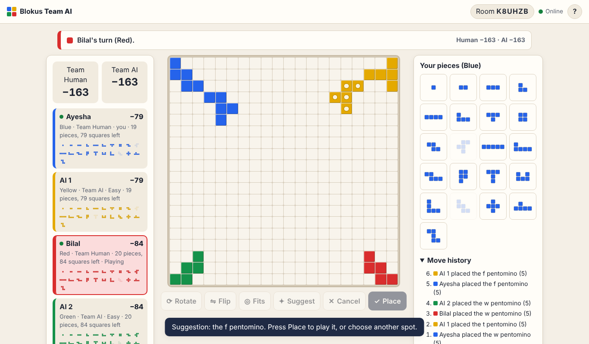
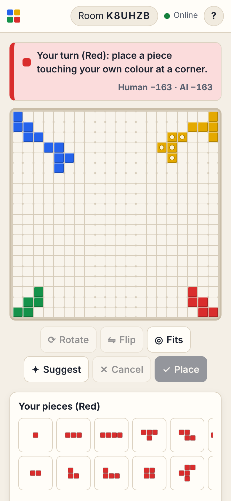

# Blokus Team AI

Browser Blokus for **two people on different devices** against **two AI
players**. One player creates a room and sends a 6-character code or link; the
other opens it anywhere in the world. No installation, no accounts, no ads.

- **Play:** <https://umairzia.github.io/Blokus-Team-AI/> (the GitHub Pages
  address; it goes live with the first successful deployment from `main`)
- **Repository:** <https://github.com/umairzia/Blokus-Team-AI>

It is a static site (TypeScript + Vite) on GitHub Pages. Online rooms are
shared through a free [Firebase Realtime Database](https://firebase.google.com/docs/database)
with anonymous sign-in. Until Firebase is configured (see
[docs/FIREBASE_SETUP.md](docs/FIREBASE_SETUP.md)) the site says so and offers
offline practice on one device.

| Laptop | Phone |
| --- | --- |
|  |  |

## Teams and turns

| Seat | Colour | Corner | Team |
| --- | --- | --- | --- |
| Human 1 (the room's host) | blue | top-left | Team Human |
| AI 1 | yellow | top-right | Team AI |
| Human 2 (the guest) | red | bottom-right | Team Human |
| AI 2 | green | bottom-left | Team AI |

Turns go clockwise and alternate teams: **Human 1 → AI 1 → Human 2 → AI 2**.
Teammates sit in opposite corners and play for a shared score, but each plays
only their own colour and pieces.

## Rules

Standard four-player Blokus on a 20 × 20 board:

- Every seat has the same 21 pieces (1 to 5 squares, 89 squares in all); each
  piece can be played once, in any rotation or reflection.
- Your first piece must cover your starting corner.
- Every later piece must touch one of your own pieces **at a corner** and must
  **not** share an edge with your own colour. Touching other colours is always
  allowed. Pieces stay on the board and never overlap.
- A seat that cannot place any piece is passed automatically and is out for
  the rest of the game (the board only fills up, so it could never move
  again). Everyone else plays on; the game ends when nobody can move.

**Scoring** (shown to players in the rules panel):

- −1 point for each square in your unplayed pieces;
- +15 if you placed all 21 pieces, and +5 more if the last one was the
  single square (monomino);
- a team scores the sum of its two seats; the higher team score wins, equal
  scores are a draw.

## Controls

- **Pick a piece** in the tray, then point at the board. The preview is solid
  when the piece fits and striped red when it does not.
- **Mouse:** click to place. **Touch:** tap to preview, then tap the same
  spot again or press **Place** (the "Confirm before placing" option, on by
  default on touch screens, does the same for mice).
- **Rotate** (R; Shift+R the other way), **Flip** (F), **Cancel** (Esc).
- **Fits** (H) marks every spot where the selected piece fits as it is turned
  now (or your open corners when no piece is selected). **Suggest** (S)
  proposes a move with the Normal AI; you still confirm it.
- **Keyboard only:** focus the board, choose pieces with `[` and `]`, move
  with the arrow keys, Enter to place.
- The seat panel shows each player's score, remaining pieces (inventory),
  turn, online/offline dot for the humans, and a thinking indicator for the
  AI. The move history lists every placement and automatic pass.

## Playing online

1. **Create:** enter your name, choose the AI level and press **Create room**.
   You get a room code like `K7PQ2M` and an invitation link
   (`https://umairzia.github.io/Blokus-Team-AI/#K7PQ2M`) to copy.
2. **Join:** your partner opens the link (or types the code under **Join a
   room**) on their own device and presses **Join**.
3. The host presses **Start game**. Both screens show the same board, turn,
   scores and history and update by themselves.
4. **Refresh or reconnect:** each browser keeps its anonymous id, so reopening
   the page (or the link, or **Continue room**) brings you back to your seat.
5. **Leave:** the guest's **Leave** frees the seat; the host's **Leave**
   closes the room for both. If a partner changes device, the host can **Free
   partner's seat** in the lobby so they can join again.

A room holds exactly two people. Anyone else with the code is refused.

## AI levels

All levels play real Blokus: they choose only from the rules engine's legal
moves and pass only when there is none. They run in a Web Worker on the host's
device so the page stays responsive.

- **Easy:** likes big pieces and keeping its own corners open, with some
  randomness; ignores everyone else.
- **Normal:** scores every legal move for the AI team as a whole: squares
  placed, open corners, and territory it can reach first, minus the same for
  the human team. So it blocks you and avoids blocking its teammate.
- **Hard:** takes Normal's ten best moves and looks a full round ahead
  (opponent, teammate, opponent), then judges by mobility and territory.

Measured with 500 paired-seed AI-vs-AI games
([details and limitations](docs/AI_EVALUATION.md)):

| Matchup | Games | Stronger side's score rate | Mean margin per pair |
| --- | ---: | ---: | ---: |
| Hard vs Normal | 200 | 88.5% (95% CI 84–93%) | +16.3 points |
| Normal vs Easy | 200 | 79.5% (95% CI 74–85%) | +10.9 points |
| Hard vs Easy | 100 | 96.0% (95% CI 92–100%) | +28.8 points |

These are AI-against-AI results; they say nothing direct about strength
against people, and Hard's look-ahead models opponents as Normal, which
favours it in the Hard-vs-Normal match.

## How it works

```
 Browser A (host)                    Firebase Realtime DB                Browser B (guest)
 ──────────────────                  ─────────────────────               ──────────────────
 UI ─ engine (rules)                 rooms/CODE/players  (seats)          UI ─ engine (preview)
 host loop: checks every move ─────► rooms/CODE/state    (v, game) ─────► redraws on change
 AI in a Web Worker                  rooms/CODE/presence (on/offline)
 answers requests ◄───────────────── rooms/CODE/req      (guest's move) ◄─ writes a request
```

- **Host-authoritative.** The host's browser validates every move with the
  rules engine (its own, the AI's, and the guest's requests), runs the AI and
  is the **only writer** of the game state. The guest writes only a move
  request for its own turn; the host applies it or answers with a reason.
- **Versioned writes.** Each state write must carry version `v + 1`, enforced
  by the database rules, so a duplicated, delayed or second-tab write can
  never apply a move twice. Moves also carry the ply number they were made
  for, so the engine itself refuses stale actions.
- **Presence.** Each browser marks itself online; Firebase marks it offline
  by itself when the connection drops.
- **Trade-off.** Because the host's browser is the authority, the game
  **pauses if the host goes offline** (the guest is told why) and continues
  when the host is back. There is no host migration.

### Security

[`database.rules.json`](database.rules.json) (tested against the official
emulator in `tests/firebase/rules.test.ts`):

- only signed-in (anonymous) users can read or write anything; nobody can list rooms;
- a room code can be created once, by someone making themselves its host;
- anyone signed in can see who is seated in a room (to know if it is full);
  only the two members can read the room itself;
- the guest seat can be claimed only while it is empty, never by the host;
  the guest can leave, and the host can free the seat but not sit in it;
- only the host writes the game state, always exactly one version newer, with
  a validated shape (board, turn, inventories, history);
- the guest can write only its own presence and a well-formed move request,
  only on its own turn and for the current version, and cannot answer it;
- only the host can delete the room.

Blokus has no hidden information, so the state itself is not secret from the
two players; the rules keep it from everyone else.

## Project structure

```
index.html                 the page
src/main.ts                entry point
src/styles.css             look and layout (light/dark, phones to desktops)
src/engine/                pure rules engine: pieces, positions, moves, scoring
src/ai/                    AI levels, evaluation, Web Worker, AI-vs-AI matches
src/network/               room protocol, host authority, Firebase / test backends
src/game/                  practice and online sessions behind one interface
src/ui/                    board, tray, panels, dialogs, keyboard handling
database.rules.json        Firebase security rules
firebase.json              Firebase CLI config (rules deploy, local emulators)
firebase.test.json         emulator config used by the automated tests
tests/                     Vitest: engine, ai, network, firebase (emulators)
e2e/                       Playwright: fake/ (two browsers), emulator/, live/
scripts/ai-eval.ts         AI evaluation harness
scripts/check-dist.mjs     build check: base path, assets, no secrets
docs/                      plan, Firebase setup, AI evaluation, screenshots
.github/workflows/ci.yml   CI and GitHub Pages deployment
```

## Running locally

Needs Node.js 22.12 or newer. The Firebase tests also need Java 11 or newer.

```bash
npm ci                 # install exactly the locked dependencies
npm run dev            # http://127.0.0.1:5173/Blokus-Team-AI/
npm run build          # production build in dist/
npm run preview        # serve dist/ at http://127.0.0.1:4173/Blokus-Team-AI/
```

Online play locally needs `.env.local` with your Firebase web settings (copy
`.env.example`), or the emulators (see [docs/FIREBASE_SETUP.md](docs/FIREBASE_SETUP.md)).

## Tests

```bash
npm run test:all            # everything below, in order (what CI runs)

npm run typecheck           # TypeScript, strict
npm run lint                # ESLint
npm run test:unit           # rules engine: pieces, placement, passing, end, scoring, property tests
npm run test:ai             # AI legality, passing, determinism, time budget, full games, strength series
npm run test:network        # two clients through the in-memory database: rooms, joins, requests,
                            # stale/duplicate handling, two host tabs, reconnects, network loss
npm run test:firebase       # official emulators: database rules + the real Firebase SDK
npm run build && npm run check:dist   # production build + base path / asset / secret check
npm run test:e2e            # two browsers via the in-memory bridge (uses dist/, so build first)
npm run build:emulator      # a build pointed at the local emulators (dist-emulator/)
npm run test:e2e:emulator   # two browsers, real SDK, through the emulators
npm run test:e2e:live       # smoke test of the live site (LIVE_URL=... to point elsewhere)
LIVE_ONLINE=1 npm run test:e2e:live   # opt-in: plays one round in a NEW room on the
                                      # real Firebase project, then deletes that room
npm run ai:eval -- --a hard --b normal --pairs 100   # AI evaluation
```

Automated tests never use production credentials: the Firebase tests run
against local emulators with the demo project `demo-blokus`.

## Deployment

`.github/workflows/ci.yml`:

- **Pull requests:** install from the lockfile, then `npm run test:all`.
  Nothing is published.
- **Pushes to `main` and manual runs:** the same checks; only if they pass,
  a production build (with the Firebase variables), the dist check, a browser
  smoke test of that exact build, upload of the Pages artifact, deployment
  to GitHub Pages, and finally a browser check of the live URL.
- Least-privilege permissions (`contents: read`; `pages: write` and
  `id-token: write` only for the deploy job); actions pinned to commit SHAs.

One-time repository setup: **Settings › Pages › Build and deployment ›
Source: GitHub Actions**; Firebase settings as repository variables
([docs/FIREBASE_SETUP.md](docs/FIREBASE_SETUP.md), step 6).

## Known limitations

- The host's browser is the authority: if it closes or goes offline, the game
  pauses until it is back. A seat belongs to the browser it was taken in;
  private windows forget it when closed (the host can free the seat).
- Abandoned rooms stay in the database until deleted in the Firebase console
  (closing a room with **Leave** deletes it).
- The host could cheat by editing its own browser (it is trusted by design;
  you are on the same team).
- The AI strength figures come from AI-vs-AI games, not games against people.
- The game needs a current browser (recent Chrome, Edge, Firefox, or Safari 16.2+).

## Troubleshooting

| What you see | What to do |
| --- | --- |
| "Online play is not set up" | Firebase is not configured for this build: [docs/FIREBASE_SETUP.md](docs/FIREBASE_SETUP.md). Offline practice still works. |
| "There is no room with that code" | Check the code, or ask for a new link: the host may have closed the room. |
| "That room already has two players" | The seats are taken. If one is yours from another device, the host can free it. |
| "The host is offline…" | The game waits for the host's browser; ask them to reopen the link. |
| The AI does not move | The AI runs on the host's device; make sure the host's tab is open and online. |
| "The database refused the request" | The rules are not published in Firebase (setup step 4). |

## License

MIT (see [LICENSE](LICENSE)), the same as the owner's Sequence-game project.
The Firebase JS SDK is Apache-2.0.

Blokus is a trademark of Mattel. This is an unofficial fan-made game, not
affiliated with or endorsed by Mattel.
